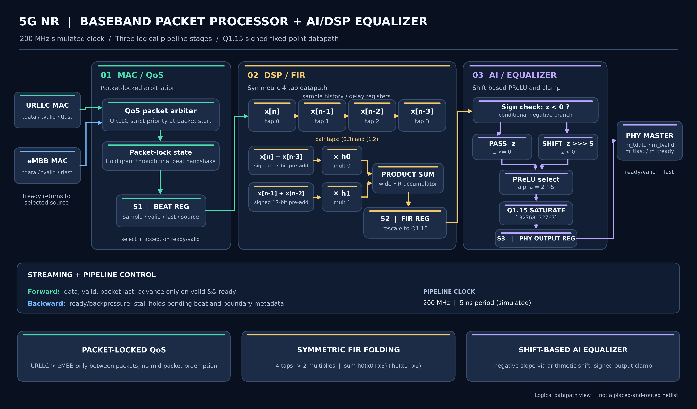
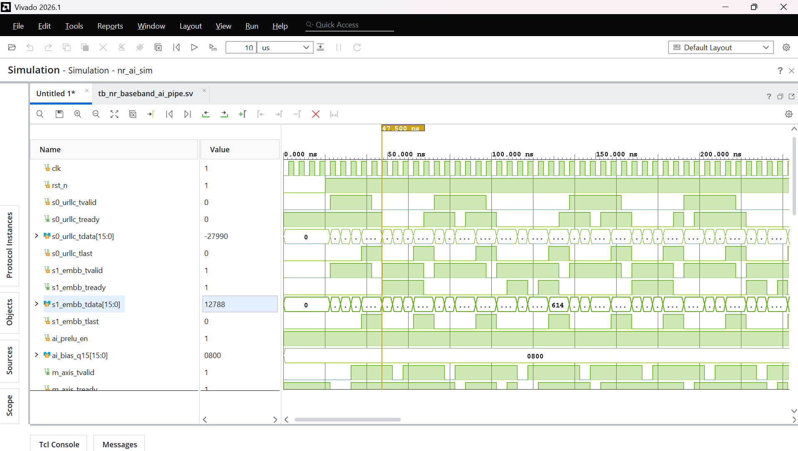
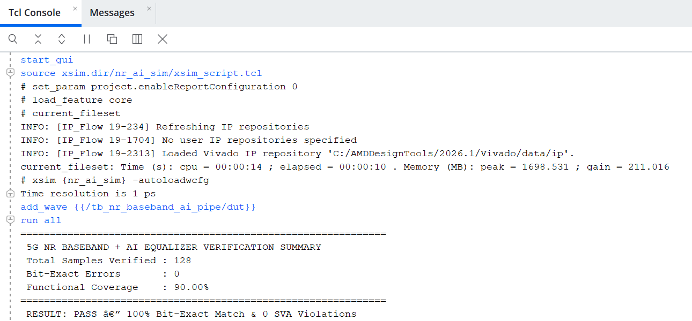

# 5G NR Baseband Packet Processor & AI/DSP Equalizer

**SystemVerilog | FPGA | DSP | AI/ML | AMD Vivado 2026.1**

A 200 MHz, 3-stage 5G NR baseband processor designed in SystemVerilog. Combines MAC-layer QoS arbitration, fixed-point FIR filtering, and a shift-based AI equalizer into a pipelined hardware datapath.

Developed and verified using AMD Vivado 2026.1, Python simulation automation, and MATLAB fixed-point modeling.

## Architecture



### Stage 1: MAC QoS Arbitration
- Packet-locked arbitration between URLLC and eMBB streams
- Strict URLLC priority at packet boundaries
- AXI4-Stream-style ready/valid handshaking
- Prevents packet interruption and data loss during backpressure

### Stage 2: Folded FIR DSP Filter
- 4-tap symmetric FIR filter using signed Q1.15 arithmetic
- Symmetric coefficient folding reduces logical multipliers from 4 to 2
- Uses pre-adders and fixed-point multiply-accumulate operations

**FIR Equation:**

```text
y[n] = h0(x[n] + x[n-3]) + h1(x[n-1] + x[n-2])
```

Filter coefficients: `[0.125, 0.375, 0.375, 0.125]`

### Stage 3: AI/DSP Equalizer
- Fixed-point rounding and configurable bias correction
- Shift-based Parametric Leaky-ReLU (PReLU) activation
- Arithmetic shifting replaces additional multiplication hardware
- Q1.15 saturation prevents output overflow

**PReLU Implementation:**

```text
PReLU(x) = x >>> 2    if x < 0 and enabled
           x          otherwise
```

The negative slope is 0.25, implemented using an arithmetic right shift.

## Verification & Simulation

The design was simulated at **200 MHz (5 ns clock period)** using AMD Vivado 2026.1.

Verification includes:
- Object-oriented constrained-random SystemVerilog testbench
- Bit-exact reference scoreboard with 0 reported errors
- Concurrent SystemVerilog Assertions (SVA)
- Functional coverage for arbitration and datapath behavior
- MATLAB fixed-point golden reference model
- Python automation for Vivado simulation

### Simulation Waveform



### TCL Console Results



The screenshots document behavioral simulation results. The 200 MHz clock is the simulated operating frequency, not a claim of post-route FPGA timing closure.

## Project Structure

```text
5g-baseband-ai-pipe/
├── MatLab/
│   └── bit_exact_5g_model.m
├── RTL/
│   └── nr_baseband_ai_pipe.sv
├── Simulation/
│   ├── run_sim.py
│   ├── waveform.png
│   └── tcl_console.png
├── TB/
│   └── tb_nr_baseband_ai_pipe.sv
├── architecture.png
└── README.md
```

## Running the Simulation

**Requirements:**
- AMD Vivado 2026.1
- Python 3
- MATLAB (optional, for independent fixed-point modeling)

Open a terminal in VS Code and navigate to the Simulation directory:

```powershell
cd Simulation
```

Run the complete simulation:

```powershell
python run_sim.py
```

Launch the Vivado waveform GUI:

```powershell
python run_sim.py --gui
```

The Python script automates SystemVerilog compilation, elaboration, and behavioral simulation using `xvlog`, `xelab`, and `xsim`.

Update the Vivado installation path in `run_sim.py` if necessary.

## Key Results

| Feature | Result |
|---------|--------|
| Architecture | 3-stage pipelined datapath |
| Simulation Clock | 200 MHz |
| HDL | SystemVerilog |
| Fixed-Point Format | Signed Q1.15 |
| FIR Filter | 4-tap symmetric |
| FIR Multiplier Reduction | 50% |
| AI Equalizer | Shift-based PReLU |
| Verification | Constrained-random, SVA, scoreboard |
| Scoreboard Errors | 0 |
| Simulation Tool | AMD Vivado 2026.1 |

## Tools & Technologies

- **HDL:** SystemVerilog
- **Design & Simulation:** AMD Vivado 2026.1 / xsim
- **Automation:** Python
- **DSP Reference Modeling:** MATLAB
- **Verification:** SVA, constrained-random testing, functional coverage
- **Hardware Concepts:** FPGA, 5G NR, AXI4-Stream, DSP, fixed-point arithmetic, AI/ML acceleration

## Project Summary

This project demonstrates RTL design and verification of a hardware-optimized 5G baseband processing pipeline. The main focus is reducing DSP hardware complexity while maintaining packet integrity, deterministic fixed-point processing, and verifiable streaming behavior.
